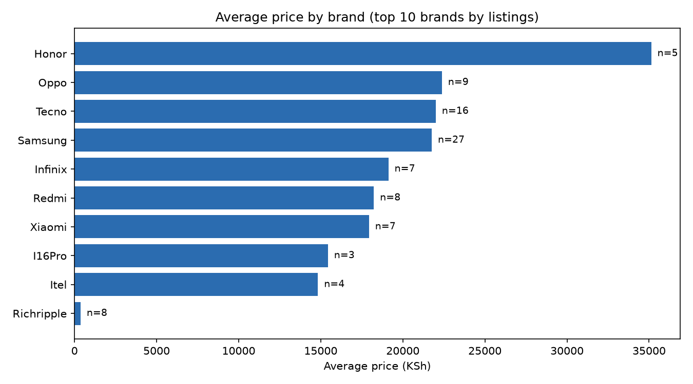
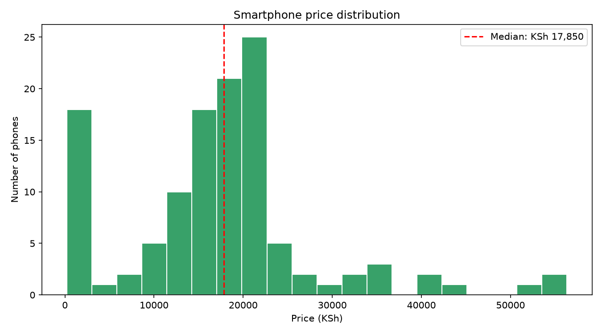
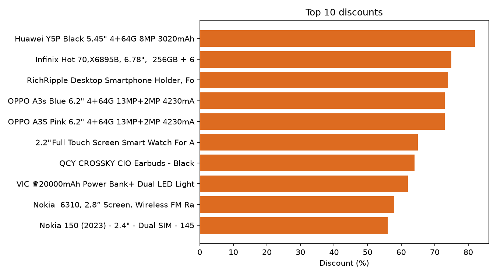

# jumia-kenya-scraper

A Python project that scrapes smartphone listings from Jumia Kenya, saves them to Excel and CSV, and generates a short price and discount analysis with charts.

## What it does
1. **Scrapes** Jumia Kenya smartphone pages 1-2 (100+ phones) with a real Chromium browser (Playwright), because plain HTTP requests are blocked with a 403 error.
2. **Extracts** name, price, old price, discount and product link for each phone.
3. **Saves** the results as `.xlsx` (opens in Excel) and `.csv` in the `data/` folder.
4. **Analyses** the latest scrape and creates charts and a summary in the `analysis/` folder.

## Requirements
- Python 3.10 or newer
- Packages listed in `requirements.txt`: beautifulsoup4, pandas, openpyxl, playwright, matplotlib

## Setup
```bash
py -m pip install -r requirements.txt
py -m playwright install chromium
```
(On Mac/Linux use `python3` instead of `py`.)

## Usage
```bash
py scraper.py            # scrape pages 1-2
py scraper.py --pages 3  # scrape more pages
py analyze.py            # build charts and summary from the newest scrape
```
A Chrome window opens during scraping and closes by itself. Leave it alone until it finishes.

## Output
- `data/jumia_smartphones_<date_time>.xlsx` - Excel table
- `data/jumia_smartphones_<date_time>.csv` - CSV copy
- `analysis/price_by_brand.png`, `analysis/price_distribution.png`, `analysis/top_discounts.png`
- `analysis/summary.md` - key numbers

## Analysis




See [analysis/summary.md](analysis/summary.md) for the key numbers.

## Project structure
```
jumia-kenya-scraper/
├── scraper.py          # scrapes Jumia and saves Excel/CSV
├── analyze.py          # creates charts and summary
├── requirements.txt
├── analysis/           # generated charts and summary
└── data/               # scraped files (not tracked by Git)
```

## Notes
- Brand is taken from the first word of each product name, so a few unusual names may be grouped imperfectly.
- Phones without a listed price are excluded from the analysis.
- The number of phones can change between runs, depending on what Jumia shows.
- If the scraper finds 0 phones, Jumia may have changed its HTML. Update the selectors in `parse_products()` in `scraper.py`.
- For learning and personal use only. Respect Jumia's terms of use and robots.txt.